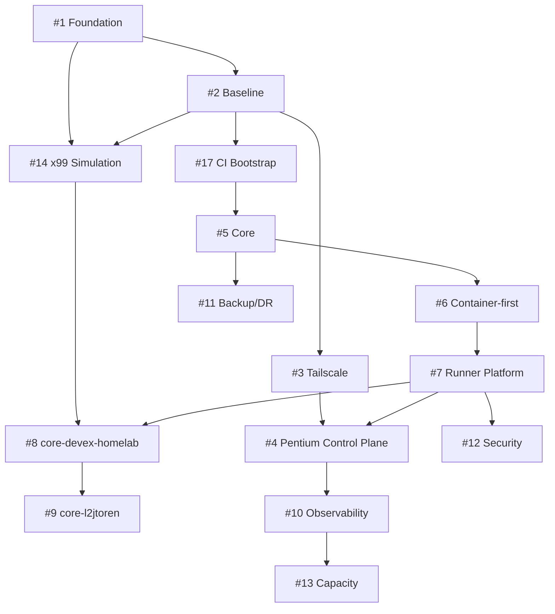

# Backlog Inicial — DevEx HomeLab

Este backlog reconstrói o trabalho já realizado no homelab e separa as próximas slices por responsabilidade. A numeração abaixo corresponde às Issues do repositório.

| Issue | Slice | Papel |
|---|---|---|
| #1 | Foundation / Governance | fonte de verdade, documentos e fluxo de trabalho |
| #2 | Inventory / Baseline | estado observado de x99, core e pentium |
| #3 | Tailscale Management Mesh | rede administrativa Tailscale-first |
| #4 | Pentium Control Plane | agent, sentinel, jobs e status por projeto |
| #5 | Core Compute Node | host mínimo e stacks Docker persistentes |
| #6 | Container-First Model | contratos e policies de execução |
| #7 | Runner Platform by Project | padrão `core-<projectname>` |
| #8 | `core-devex-homelab` | runner e CI do próprio HomeLab |
| #9 | `core-l2jtoren` | migração segura do runner L2jToren |
| #10 | Observability / Drift | desired × observed state |
| #11 | Backup / DR | backup, restore e recuperação |
| #12 | Security | hardening, secrets e fronteiras privilegiadas |
| #13 | Capacity | budgets e concorrência do Core |
| #14 | x99 Docker Simulation | topologia lógica `sim-core` + `sim-pentium` |
| #17 | Foundation CI Bootstrap | primeiro gate GitHub antes de deploy físico |

## Dependências principais

A ordem não implica que toda documentação precise esperar pelas anteriores, mas nenhuma implantação pode avançar sobre dependência operacional não certificada.
