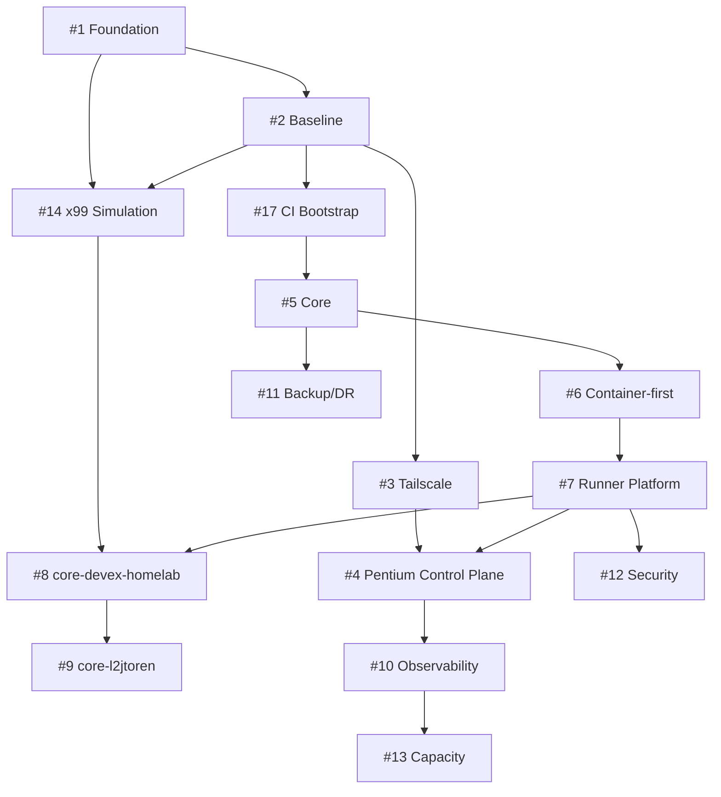

# Backlog Inicial — DevEx HomeLab

Este backlog reconstrói o trabalho já realizado no homelab e separa as próximas slices por responsabilidade. A numeração abaixo corresponde às Issues do repositório.

| Issue | Slice | Papel | Status |
|---|---|---|---|
| #1 | Foundation / Governance | fonte de verdade, documentos e fluxo de trabalho | Concluído |
| #2 | Inventory / Baseline | estado observado de x99, core e pentium | Concluído |
| #3 | Tailscale Management Mesh | rede administrativa Tailscale-first | Concluído |
| #4 | Pentium Control Plane | agent, sentinel, jobs e status por projeto | Concluído |
| #5 | Core Compute Node | host mínimo e stacks Docker persistentes | Concluído |
| #6 | Container-First Model | contratos e policies de execução | Concluído |
| #7 | Runner Platform by Project | padrão `core-<projectname>` | Concluído |
| #8 | `core-devex-homelab` | runner e CI do próprio HomeLab | Concluído |
| #9 | `core-l2jtoren` | migração segura do runner L2jToren | Concluído |
| #10 | Observability / Drift | desired × observed state (`drift_detector.py`) | Concluído |
| #11 | Backup / DR | backup idempotente Restic + GitHub Releases vault | Concluído |
| #12 | Security | hardening, no-new-privileges e isolamento | Concluído |
| #13 | Capacity | budgets cgroups e concorrência do Core | Concluído |
| #14 | x99 Docker Simulation | topologia lógica `sim-core` + `sim-pentium` | Concluído |
| #17 | Foundation CI Bootstrap | primeiro gate GitHub antes de deploy físico | Concluído |
| #18 | Atlas 2.0 / Hermes Background | migração cognitiva, prompt estruturado e Discord Gateway | Concluído |
| #19 | Atlas 3.0 / Governador Afetivo | 20 sentimentos canônicos, resiliência de backoff e expurgo SQLite | Concluído |
| #20 | Tecido Sensorial SSH & L2jToren | sondas determinísticas TCP, flash query no x99 e runbook operacional | Concluído |
| #21 | Atlas 4.0 / Propriocepção & Autonomia | Grafo de Memória M3, Propriocepção Contínua e Gestão Proativa de Tarefas | Concluído |

## Dependências principais

A ordem não implica que toda documentação precise esperar pelas anteriores, mas nenhuma implantação pode avançar sobre dependência operacional não certificada.
