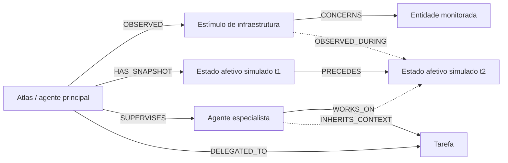

# Atlas como agente principal — grafo operacional/afetivo (2026-10-15)

## Invariante de identidade e autonomia

**Atlas = agente pessoal/orquestrador e dono do plano de controle.** A infraestrutura é permanentemente observada por serviços dedicados, com triagem, políticas e execução auditável. **Hermes = modelos e agentes de inferência**, não o proprietário do sistema. O Discord usa **atlas-discord.service**, gateway próprio. Agentes auxiliares recebem tarefas específicas e reportam evidências ao Atlas; não ganham poderes por terem herdado contexto.

A palavra *emoção* designa apenas **variáveis artificiais do motor afetivo**, não consciência, sentimentos experimentados nem capacidade de sofrimento. O estado contextual pode influenciar **prioridade, foco e forma de comunicar**, mas **jamais** contorna segurança, autorização humana ou orçamento. Agentes filhos recebem uma cópia de observações e limites do pai, **não** um estado emocional global mutável compartilhado.

## Fontes já existentes (auditadas)

- `atlas-observation.service`: processo contínuo de observação e estímulos.
- `affective-state.json`: o motor guarda seis métricas validadas: `valencia` (-1 a +1), `ativacao`, `estresse`, `confianca`, `engajamento` e `curiosidade` (0 a 1).
- `cognitive-observation-context.json`: carimbo de tempo, observações recentes e `source_stimulus_id`.
- `memory_graph.py`: grafo semântico de longo prazo já existente. **Não** é substituído nem misturado com a linha temporal.
- `agency_specialists.py`: colaboração de especialistas sob supervisão e políticas do Atlas; a integração com seu ciclo de vida real ainda está pendente.

## Grafo temporal implementado

Banco: `~/pentium-agent/atlas/runtime/operational-affective-graph.sqlite3` (SQLite).
Exportação local programável: `~/pentium-agent/atlas/runtime/operational-affective-graph.json`, limitada por execução a 200 nós/arestas/amostras.

**Nós:** `atlas`, `agent`, `task`, `stimulus`, `entity`, `affect_snapshot`.

**Arestas:** `SUPERVISES`, `DELEGATED_TO`, `WORKS_ON`, `OBSERVED`, `CONCERNS`, `HAS_SNAPSHOT`, `PRECEDES`, `OBSERVED_DURING`, `INHERITS_CONTEXT`.



As relações `CONCERNS` e `OBSERVED_DURING` não alegam causa. `affect_transitions` oferece deltas das seis métricas entre instantes e, quando há vínculo confiável, os IDs de estímulos observados no mesmo contexto, com `causality=unverified_temporal_association`.

**Contrato de delegação:** `OperationalAffectiveGraph.delegate(agent_id,task_id,parent_id='atlas')` só funciona se o agente pai está registrado e possui um estado medido. Retorna `AgentAffectiveEnvelope` com contexto **copiado e imutável**, timestamp, `snapshot_id` e IDs de pai, filho e tarefa; não autoriza ações nem cria processo/worker. O projeto precisa chamar isso no dispatcher real em um checkpoint posterior.

**Proteção de dados:** não guarda prompts, respostas, texto de chat, credenciais, payload de estímulos, descrições de pessoas nem `foco_atencao` potencialmente privado. IDs de correlação são pseudonimizados por hash. SQLite deduplica observações e snapshots; exportação é limitada, não exposta publicamente.

## Coleta ativa no pentium

- Módulos instalados **isoladamente** em `~/.local/share/atlas-operational-graph/infrastructure/pentium/atlas/`, sem alterar checkout existente.
- `atlas-operational-graph.timer` e `atlas-operational-graph.service` (systemd user). O motor de observação opera continuamente; o grafo lê uma fotografia a cada ~1 minuto.
- Validação live (2026-10-15): coletou 8 observações aceitas/0 rejeitadas e, nas execuções do serviço seguintes, obteve 22 nós, 34 arestas e 3 amostras afetivas.
- Testes `test_operational_affective_graph` e `test_operational_graph_snapshot`: 11/11 Windows e 11/11 Linux aprovados antes de ativar.
- O consumidor do Discord continua sendo o gateway Atlas, **não** o Hermes. Este checkpoint cria telemetria para seu dashboard, **não** dispara mensagens emocionais automaticamente.

## Próximos gates — não confundir com concluído

1. Vincular `delegate()` ao verdadeiro ciclo de vida dos especialistas e registrar `agent_started`, `agent_completed`, `agent_failed`, ferramentas e decisões, com políticas herdadas e níveis de aprovação.
2. Registrar evidências causais testáveis: intervenção/alteração, antes/depois, confiança da hipótese, falso positivo e validação independente. Correlação **não prova** que incidentes mudaram o estado afetivo.
3. Dashboard visual por agente e por host com histórico temporal, exploração de nós, consulta de subgrafos, segurança/privacidade e limites de retenção.
4. Segurança 24/7: inventário de cobertura, eventos auditáveis de rede/serviços/vulnerabilidades e resposta escalonada com autorização apropriada. Este grafo **não** significa que já existe auditoria completa de segurança.
5. Conversa proativa por gateway Atlas, cooldown, limites de horário/frequência, severidade e opção de silenciar; crítica verdadeira pode avisar de imediato. Não enviar mensagens repetitivas nem depender de estado afetivo para impor obrigações ao usuário.

Comandos de auditoria local:

```bash
systemctl --user list-timers atlas-operational-graph.timer
journalctl --user -u atlas-operational-graph.service -n 15 --no-pager
python3 -m json.tool ~/pentium-agent/atlas/runtime/operational-affective-graph.json
```
