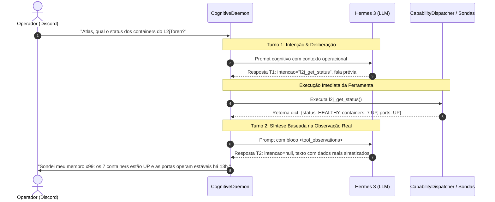

# Atlas ReAct Loop (Hermes Agent Pattern) — Design de Domínio

## 1. Visão Geral e Motivação

Historicamente, o Atlas operava em modo **Single-Shot (Turno Único)**: ao ser estimulado por uma mensagem humana ou evento de observação, o modelo Hermes 3 formulava uma única resposta JSON contendo uma fala e uma intenção de ação. Embora eficiente, esse fluxo apresentava uma limitação fundamental: a fala era gerada *antes* de a ferramenta executar, impedindo que o Atlas respondesse com os dados reais colhidos da infraestrutura.

O **Atlas ReAct Loop** implementa o padrão clássico de agentes autônomos (**Thought $\rightarrow$ Action $\rightarrow$ Observation $\rightarrow$ Synthesis**), tirando proveito das capacidades nativas do **Hermes 3** para raciocínio com ferramentas (*XML Tool Calling* e *Chain-of-Thought*).

---

## 2. Princípios de Segurança e Não-Regressão

1. **Retrocompatibilidade e Não-Regressão**:
   - Diálogos comuns (conceituais, arquiteturais ou conversacionais) permanecem em **Turno 1 único**, sem qualquer latência ou consumo de tokens adicional.
2. **Orçamento Bounded no Hardware (Pentium 2C/2T)**:
   - Teto estrito de **máximo 2 turnos** (`max_react_turns = 2`): Turno 1 (Percepção & Escolha de Ferramenta) $\rightarrow$ Execução da Tool $\rightarrow$ Turno 2 (Síntese Conclusiva).
3. **Segurança Default-Deny**:
   - Somente capabilities de **LEITURA e DIAGNÓSTICO** (`l2j_*`, `git_*`, `get_cluster_vitals`, `get_host_status`, `workspace_search`) são elegíveis para auto-execução no loop.
   - Ações de controle ou modificação que exijam confirmação (`requer_confirmacao = true`) NUNCA entram em loop autônomo e aguardam autorização humana explícita.
4. **Fallback Gracioso**:
   - Se a ferramenta falhar ou o Turno 2 sofrer timeout, a resposta original do Turno 1 é entregue sem perda de mensagens.

---

## 3. Ciclo de Execução ReAct



---

## 4. Contrato Estruturado do Prompt (`hermes_adapter.py`)

No Turno 2, as observações reais das ferramentas são injetadas em tags XML dedicadas:

```xml
<tool_observations>
OBSERVAÇÕES REAIS COLHIDAS DAS FERRAMENTAS DO CLUSTER:
<tool_observation capability="l2j_get_status">
{
  "target_host": "100.101.23.111",
  "overall_status": "HEALTHY",
  "critical_services_online": true,
  "containers": {
    "l2jtoren-gameserver": {"status": "Up 13 hours"},
    "l2jtoren-loginserver": {"status": "Up 13 hours"}
  }
}
</tool_observation>

DIRETRIZ DE SÍNTESE REAT/REACT:
Você acabou de executar as ferramentas acima. Agora formule no campo 'texto' sua resposta FINAL para o operador incorporando os dados reais obtidos. Defina 'intencao': null e 'parametros_intencao': {} já que a consulta já foi realizada com sucesso.
</tool_observations>
```

---

## 5. Garantia de Cobertura de Testes

- Validado em `infrastructure/pentium/atlas/tests/test_react_loop.py`:
  - `test_react_loop_executes_tool_and_synthesizes_turn_2`: Comprova que a ferramenta executa, o Turno 2 recebe a observação e a resposta final é entregue.
  - `test_plain_dialogue_does_not_trigger_turn_2`: Comprova que conversas comuns não realizam turnos adicionais.
- Bateria completa: `782 passed, 3 skipped, 28 subtests passed` (100% GREEN).
