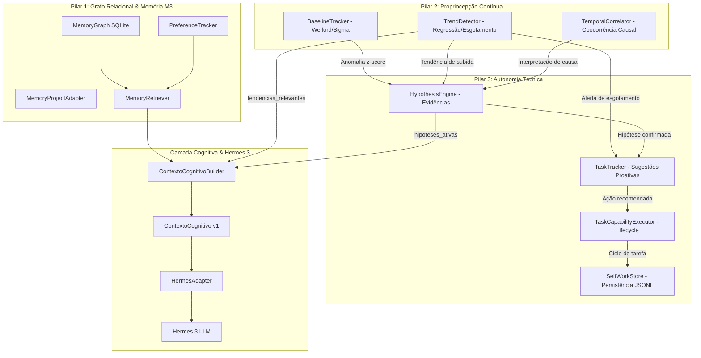

# Atlas 4.0: Grafo de Memória, Propriocepção Contínua & Autonomia Técnica — Design de Domínio

## 1. Visão Geral

O **Atlas 4.0** eleva a consciência computacional do DevEx HomeLab além da observação reativa pontual, introduzindo **compreensão relacional profunda, sensibilidade temporal preditiva e autonomia proativa segura** estruturada em três pilares fundamentais:

- **Pilar 1 — Grafo Relacional & Memória Operacional M3**: Topologia viva de entidades do cluster, nós, repositórios, serviços e preferências do operador, combinada com retrieval semântico ponderado.
- **Pilar 2 — Propriocepção Contínua & Detecção de Tendências**: Baselines estatísticos adaptativos (Welford), regressão linear com projeção de esgotamento de recursos e correlação temporal causal entre nós e serviços.
- **Pilar 3 — Autonomia Técnica & Gestão Proativa de Tarefas**: Motor formal de hipóteses técnicas (formulação, evidências pró/contra, resolução), rastreador unificado de tarefas e execução delimitada por orçamento e persistência local.

---

## 2. Princípios Arquiteturais e Orçamento de Recursos

1. **Eficiência no Hardware Bounded (Pentium Dual-Core T4300, 2C/2T, 2.5 GiB RAM)**:
   - O cálculo estatístico de baselines utiliza o algoritmo de **Welford** ($O(1)$ de espaço e tempo por amostra), dispensando armazenamento de séries temporais brutas em memória.
   - O detector de tendências opera sobre janelas deslizantes enxutas ($N \le 20$), calculando regressão linear via soma acumulada sem sobrecarga computacional.
   - O grafo de conhecimento e as memórias são persistidos em SQLite local com índices B-Tree e serialização JSON limpa.
2. **Determinismo Físico e Separação de Preocupações**:
   - Desvios, tendências e correlações causais são detectados puramente via telemetria matemática. A LLM (Hermes 3) **não calcula métricas**, mas sim interpreta os dados consolidados para síntese humana e deliberação proativa.
3. **Autonomia Bounded com Default-Deny**:
   - Tarefas autônomas operam sob tetos rígidos de operações e ciclos de inferência (`operations_used`, `inferences_used`).
   - Ações destrutivas ou mudanças de infraestrutura crítica continuam exigindo autorização humana explícita (`requer_confirmacao = true`).

---

## 3. Os Três Pilares da Arquitetura 4.0



---

## 4. Detalhamento dos Componentes

### 4.1 Pilar 1: Grafo Relacional & Memória M3
- **`MemoryGraph` (`memory_graph.py`)**: Grafo relacional bidirecional mapeando nós (`node:pentium`, `node:x99`, `node:core`), projetos (`proj:l2jtoren`, `proj:devex-homelab`), serviços e credenciais.
- **`MemoryProjectAdapter` (`memory_project_adapter.py`)**: Auto-população da topologia baseline do homelab e sincronização com repositórios e serviços.
- **`PreferenceTracker` (`memory_preference_tracker.py`)**: Rastreamento incremental de afinidades do operador (horários ativos, tópicos de interesse, estilo de resposta).
- **`MemoryRetriever` (`memory_retriever.py`)**: Busca híbrida que cruza similaridade semântica no `MemoryStore` v3 com subgrafos de entidades e pesos de preferências.

### 4.2 Pilar 2: Propriocepção Contínua
- **`BaselineTracker` (`proprioception/baseline_tracker.py`)**: Mantém média, variância e desvio padrão incrementais por métrica/nó via Welford. Exige histerese consecutiva configurável (default: 3 ciclos) antes de emitir `BaselineDeviation`, eliminando falsos positivos por picos isolados.
- **`TrendDetector` (`proprioception/trend_detector.py`)**: Regressão linear por mínimos quadrados ($R^2$, inclinação) que calcula a velocidade de degradação e projeta o horizonte de esgotamento (`exhaustion_hours`) para métricas de capacidade (RAM, disco, conexões).
- **`TemporalCorrelator` (`proprioception/temporal_correlator.py`)**: Identifica padrões de coocorrência temporal com janela bounded (default: 300s), associando eventos emparelhados a regras diagnósticas conhecidas (ex: pressão de RAM no Pentium correlacionada a spikes de latência no L2jToren).

### 4.3 Pilar 3: Autonomia Técnica
- **`HypothesisEngine` (`autonomy/hypothesis_engine.py`)**: Deliberação científica estruturada (`PROPOSED` $\rightarrow$ `INVESTIGATING` $\rightarrow$ `CONFIRMED` / `REFUTED` / `INCONCLUSIVE`). Atualiza dinamicamente o nível de confiança com base no balanço de evidências acumuladas.
- **`TaskTracker` (`autonomy/task_tracker.py`)**: Rastreia tarefas técnicas abertas, ordenadas por prioridade (`CRITICAL` $\rightarrow$ `HIGH` $\rightarrow$ `MEDIUM` $\rightarrow$ `LOW` $\rightarrow$ `INFO`), com dedup por `source_ref` e geradores inteligentes (`suggest_from_trend`, `suggest_from_hypothesis`).
- **`SelfWorkStore` & `TaskCapabilityExecutor` (`task_store.py`, `task_capability_executor.py`)**: Orquestração segura via capabilities allowlisted (`task_status`, `task_create`, `task_complete`, `task_abandon`), com persistência contínua que sobrevive a reinicializações de daemons.

---

## 5. Contrato de Injeção no Prompt Hermes 3 (`hermes_adapter.py`)

No contexto cognitivo, as tendências e hipóteses são encapsuladas em blocos XML dedicados:

```xml
<proprioceptive_trends>
TENDÊNCIAS PROPRIOCEPTIVAS E DESVIOS DOS SEUS NÓS:
- Métrica: pentium:ram_percent | Tendência: RISING (inclinação: 0.05, confiança R²: 0.95) | Esgotamento projetado: 4.5h | Desvio z-score: 2.80 | Coocorrência correlacionada: l2j_latency_spike | Diagnóstico: Gargalo de memória gerando contenção de I/O
</proprioceptive_trends>

<active_hypotheses>
HIPÓTESES TÉCNICAS E DIAGNÓSTICOS EM INVESTIGAÇÃO:
- [INVESTIGATING] hypo-leak-pentium: Vazamento gradual de RAM no coletor (confiança: 0.85)
</active_hypotheses>
```

Se esses blocos não existirem na ativação atual, o prompt omite as tags completamente, garantindo zero sobrecarga de tokens em conversas triviais.

---

## 6. Cobertura de Testes Automatizados

O sistema conta com suítes dedicadas de integração e empacotamento:
1. `test_pilar1_packaging_integration.py`: Empacotador e roundtrip completo do Grafo de Memória M3.
2. `test_pilar2_packaging_integration.py`: Empacotador e roundtrip completo da Propriocepção Contínua.
3. `test_pilar3_packaging_integration.py`: Empacotador e roundtrip completo da Autonomia Técnica.
4. Totalizando **887 testes unitários e de integração com 100% de aprovação**.
