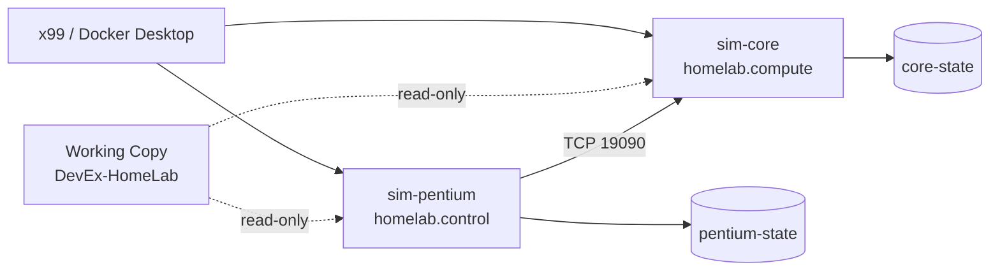
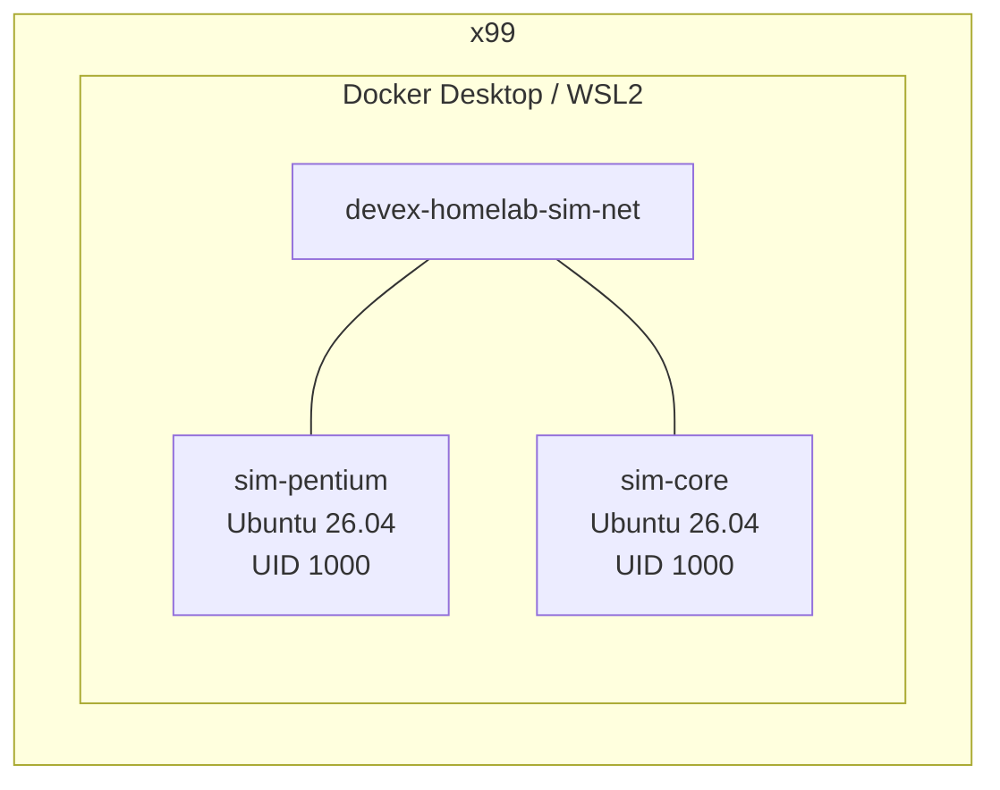
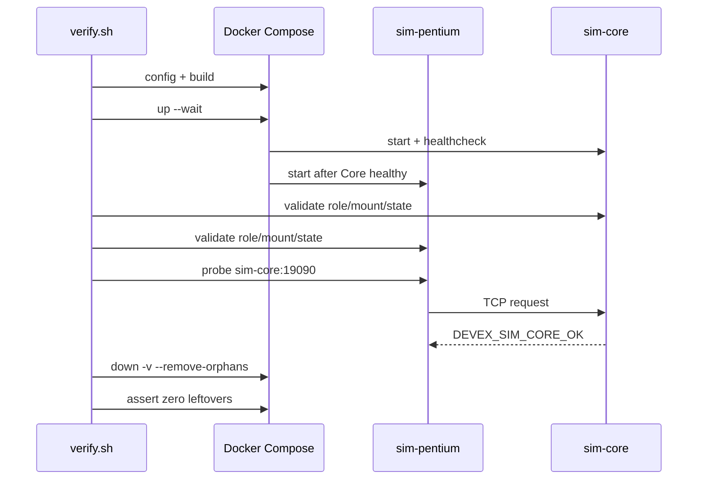

# UML — Simulação Docker na x99

Issue: #14

## Component Diagram

## Deployment Diagram

## Certification Sequence

A simulação representa somente contratos lógicos; hardware e serviços de host permanecem fora deste deployment.